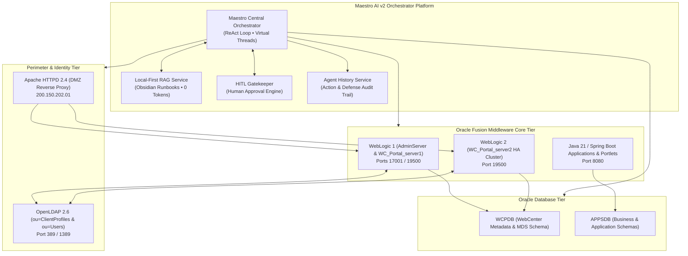

# Maestro AI v2 — Multi-Agent SRE & Oracle WebCenter Portal Architecture

**Maestro AI v2** is an enterprise-grade **Java 21 & Spring Boot** Multi-Agent Site Reliability Engineering (SRE) and Middleware platform. It coordinates **10 specialized infrastructure and security sub-agents** using **Java 21 Virtual Threads (Project Loom)** to monitor, diagnose, and remediate enterprise middleware stacks (Oracle WebCenter Portal, WebLogic Cluster, Apache DMZ, OpenLDAP, Java Spring, and Oracle Databases).

It features a **Local-First Zero-Token RAG Engine** (Obsidian Markdown runbooks), an **Active Cybersecurity Shield** with dynamic CAPTCHA challenges, **OpenLDAP-driven multi-tenant profile resolution**, **Human-in-the-Loop (HITL)** remediation safeguards, and a suite of **independent front-end screens** adhering to the corporate visual identity of Oracle WebCenter Portal.

---

## 🏛️ System Architecture



---

## 👥 The 10 Specialized Sub-Agents

All sub-agents are executed concurrently via **Java 21 Virtual Threads**, ensuring ultra-low latency without blocking thread pools:

| # | Agent Name | Domain & Class | Core Responsibilities |
| :-: | :--- | :--- | :--- |
| **1** | **Maestro Central** | `MaestroOrchestrator` | Decomposes natural-language incident reports into structured multi-agent ReAct plans. Consults local runbooks first to eliminate external LLM token costs. |
| **2** | **Cybersecurity Specialist** | `CyberSecuritySkill` | Real-time active shield against SQLi, XSS, and credential stuffing. Generates cryptographic CAPTCHA challenges and manages in-memory IP blocklists. |
| **3** | **Middleware Architect** | `MiddlewareArchitectSkill` | Analyzes Oracle Fusion Middleware (14c/12c) topology, cluster replication, Coherence*Web session state, and cloud-interoperability guidelines. |
| **4** | **WebCenter Portal Specialist** | `WebCenterPortalSkill` | Automates portal provisioning via native REST APIs (`/rest/api/v1/portals`), enforces universal page template (`.aar`) standards, and applies dynamic themes (`--portal-primary`). |
| **5** | **Java / Spring Specialist** | `JavaSpringSkill` | Monitors Spring Boot Actuator endpoints (`/health`, `/metrics`), inspects JVM Heap, Metaspace, and analyzes Garbage Collection pauses (`jstat -gcutil`). |
| **6** | **SRE Monitoring Specialist** | `MonitoringSreSkill` | Evaluates real-time availability SLAs/SLOs across all 8 monitored nodes and generates technical backing reports for corrective actions. |
| **7** | **WebLogic Specialist** | `WebLogicWcpSkill` | Provisions Managed Servers and JDBC DataSources via REST Management APIs, inspects `ThreadPoolRuntime`, and detects Stuck/Hogging threads. |
| **8** | **Linux Specialist** | `LinuxLogSkill` | Audits OS metrics (load, `/u01` disk utilization), tails non-sudo Apache logs, and correlates internal WebCenter diagnostic codes (`WCS#...`). |
| **9** | **Oracle DBA Specialist** | `OracleDbaSkill` | Generates DDL scripts for `WCPDB` and `APPSDB` schemas, runs canonical `SELECT 1 FROM DUAL` latency probes, and inspects locks and invalid objects. |
| **10**| **OpenLDAP Specialist** | `OpenLdapSkill` | Manages directory trees, executes authenticated LDAP binds, resolves multi-tenant client profile groups (`ou=ClientProfiles`), and audits `contextCSN` replication. |

---

## 🖥️ Three Dedicated Independent Web Screens

Instead of a cluttered single-page view, the application provides three independent interfaces:

1. **🔐 Corporate Login (`/login.html` or `/login`)**
   * Authentic Oracle WebCenter Portal corporate login interface (Claro Empresas / Primesys).
   * **OpenLDAP-driven:** User enters username and password; access profile and portal layout are resolved dynamically from OpenLDAP groups.
   * **Active CAPTCHA:** High-contrast graphic SVG mathematical challenge validated by the Cybersecurity Agent before LDAP authentication.
   * **Simulation helpers:** Includes one-click test credentials for LDAP profiles (`joao.silva` $\rightarrow$ Enterprise, `maria.gold` $\rightarrow$ Premium, `carlos.parceiro` $\rightarrow$ Partner) and attack tests (SQLi, XSS, Invalid Captcha).

2. **🌐 WebCenter Portal Main View (`/portal.html` or `/portal`)**
   * Multi-tenant portal view rendered after successful login.
   * Dynamically applies the customer's primary theme color (`#004e8b` Enterprise, `#b71c1c` Premium, `#1b5e20` Partner).
   * Displays authorized navigation modules (*Dashboard SLA*, *Dedicated Topology*, *Contracts & Invoices*, *Trouble Tickets*, *REST API Catalog*).
   * Data grids and technical metadata linking directly to native REST endpoints (`/rest/api/v1/portals/{name}`).

3. **🎛️ Lean SRE Monitoring Console (`/monitor.html` or `/monitor`)**
   * Dedicated operator console split into clean sections:
     * **Top Strip:** Compact status of all 8 nodes (Apache DMZ, WebLogic Admin, WC_Portal 1 & 2, APP_server 1 & 2, OpenLDAP, Oracle DB) with live latency and health indicators.
     * **Left Column:** Ad-hoc incident resolution chat with the Maestro Orchestrator (quick chips for 504 Gateway Timeout, Stuck Threads, LDAP Bind failures, Oracle Locks, and Cybersecurity Shield).
     * **Right Column:** Chronological audit trail of agent actions, automated defenses, HITL approvals, and learned procedures.

---

## 🚀 Quick Start Guide

### Prerequisites
* **Java 21+** (`java -version`)
* **Apache Maven 3.9+** (`mvn -v`)
* **Podman** or **Docker** (optional, for containerized execution)

---

### 1. Build and Run Tests
All unit and multi-agent integration tests run standalone with zero external dependencies in simulation mode:
```bash
cd app
mvn clean test
```
*Result: **15 tests run, 0 failures, 0 errors** (`BUILD SUCCESS`).*

---

### 2. Run Locally in Standalone Development Mode
```bash
cd app
mvn spring-boot:run
```
Once started, access the independent screens in your browser:
* **Portal Login:** [http://localhost:8080/login.html](http://localhost:8080/login.html)
* **WebCenter Portal:** [http://localhost:8080/portal.html](http://localhost:8080/portal.html)
* **SRE Monitor:** [http://localhost:8080/monitor.html](http://localhost:8080/monitor.html)

---

### 3. Run with Podman Local (`infra/podman-compose.yml`)

#### Fast Dev / Simulation Mode (Orchestrator container, <500 MB RAM):
```bash
cd infra
podman-compose up -d agent-orchestrator
```

#### Full Infrastructure Stack (Apache DMZ, OpenLDAP, Oracle DB 23ai, WebLogic WCP):
```bash
cd infra
podman-compose --profile full-infra --profile full-infra-wcp up -d
```

---

## 🔒 Security & Human-in-the-Loop (HITL) Gatekeeper

All remediation proposals generated by agents (e.g., node restarts, thread dumps, firewall rule updates) are assigned a risk level (`LOW`, `MEDIUM`, `HIGH`) and must be approved or rejected by an operator via the `/api/hitl/decision` endpoint or the interactive modal in the SRE console.

---

## 📦 Project Structure

```
Maestro_AI_v2/
├── app/                                 # Spring Boot & Java 21 Backend
│   ├── src/main/java/com/corp/ai/agents/
│   │   ├── config/                      # AppProperties & WebMvc configuration
│   │   ├── controller/                  # REST & SSE Controllers (Portal, Chat, Infra, HITL, History)
│   │   ├── model/                       # DTOs, thought events, and HITL decision models
│   │   ├── orchestrator/                # MaestroOrchestrator ReAct engine
│   │   ├── service/                     # RAGService, HitlService, AgentHistoryService, JMX, LDAP, SSH
│   │   └── skills/                      # 10 Specialized Sub-Agents
│   ├── src/main/resources/
│   │   ├── static/                      # Independent Front-end Screens
│   │   │   ├── login.html               # Corporate Login with CAPTCHA
│   │   │   ├── portal.html              # Multi-tenant WebCenter Portal View
│   │   │   ├── monitor.html             # Lean SRE Monitoring Console
│   │   │   ├── css/                     # portal-theme.css & monitor-theme.css
│   │   │   └── js/                      # portal-login.js, portal-main.js, monitor-main.js
│   │   └── application.yml              # Profiles and default properties
│   └── pom.xml                          # Maven build definition
├── infra/                               # Containerization & Infrastructure
│   ├── Containerfile                    # Multi-stage Java 21 non-root container
│   ├── podman-compose.yml               # Podman compose stack definition
│   └── .env.example                     # Environment template
├── knowledge/                           # Zero-Token Local-First RAG Base (Obsidian)
│   ├── 00_Indice_Memoria_Local_First.md # Master knowledge index
│   ├── cybersec/                        # Cybersecurity attack patterns & mitigation
│   ├── infra/                           # WebLogic, Oracle DBA & LDAP procedures
│   ├── runbooks/                        # Step-by-step incident runbooks (504, Stuck Threads, etc.)
│   └── webcenter/                       # Universal layout and REST API guides
├── .gitignore                           # Git ignore rules for build artifacts & credentials
└── README.md                            # Complete architecture and operation guide
```

---

## 📄 License & Compliance
Proprietary & Confidential — Developed for enterprise architecture evaluations and SRE automation benchmarks.
