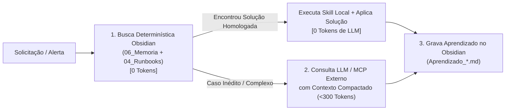

---
tags:
  - memoria-agentes
  - token-economy
  - local-first
  - rag-obsidian
status: ATIVO
updated: 2026-11-13
---

# 🧠 Índice de Memória e Aprendizado Contínuo (Local-First / Zero-Token)

> **Regra de Ouro para Todos os 10 Agentes:**  
> Antes de acionar qualquer LLM externo (Gemini/Claude) ou MCP externo, **consulte obrigatoriamente esta base local no Obsidian**. Se o padrão do incidente, ataque ou provisionamento já estiver documentado abaixo, utilize a solução validada localmente (**Custo = 0 Tokens**) e registre novos aprendizados ao concluir a tarefa.

---

## 📂 Estrutura da Memória dos Agentes

1. [[Aprendizado_CyberSec_Ataques|🛡️ Memória do Especialista em Cibersegurança (Defesa Online & Mitigação)]]
   - Assinaturas de ataques externos (SQLi, XSS, Brute-Force LDAP, DDoS/Flood, Scanner de Vulnerabilidades).
   - Ações de defesa ativa online (IP Blacklist em tempo real, Rate Limiting, WAF ModSecurity e proteção de Captcha).
2. [[Aprendizado_WebCenter_Layouts_e_Portais|🎨 Memória do Especialista em WebCenter Portal (Layout Universal & REST APIs)]]
   - Uso obrigatório do template padrão `layout/portal-universal-template`.
   - Provisionamento via REST API (`/rest/api/v1/portals`) nas versões **14c (14.1.2.0.0)** e **12c (12.2.1.4.0)**.
   - Entrada única com visualizações distintas por cliente via atributo `corPrimaria` e perfis do OpenLDAP.
3. [[Aprendizado_Infra_WebLogic_Oracle_LDAP|⚙️ Memória de Middleware, WebLogic, Linux, Oracle DBA & OpenLDAP]]
   - Provisionamento de novos Managed Servers e DataSources no WebLogic.
   - Provisionamento de schemas nos bancos do Portal (`WCPDB`) e de Aplicações (`APPSDB`).
   - Criação de usuários e grupos multi-cliente no OpenLDAP e análise de logs no Linux.

---

## 🔄 Fluxo de Economia de Tokens (Hierarquia de Busca)

